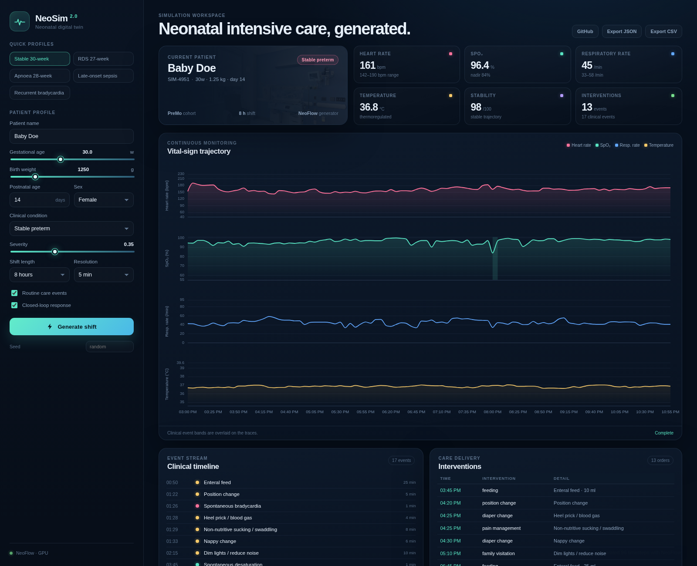
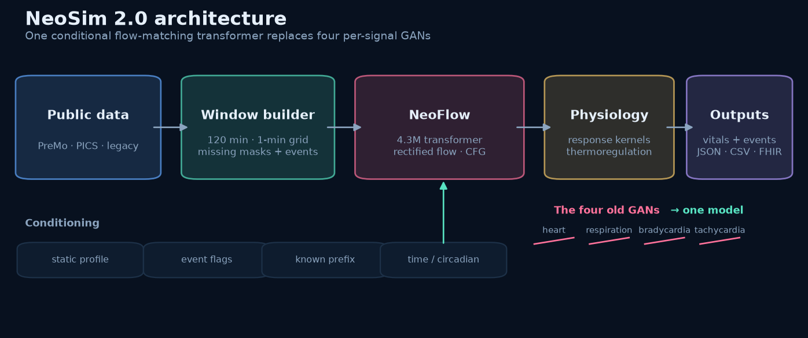
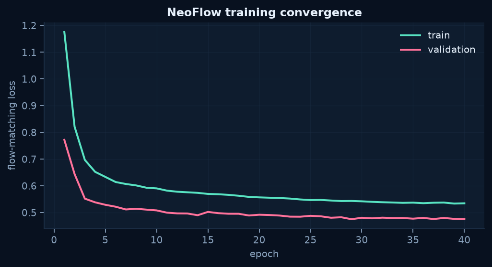
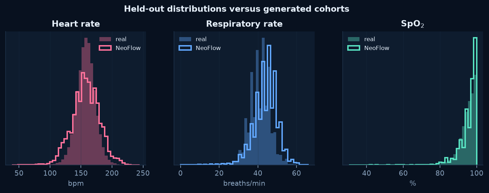
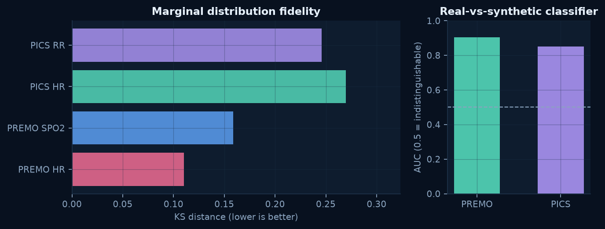
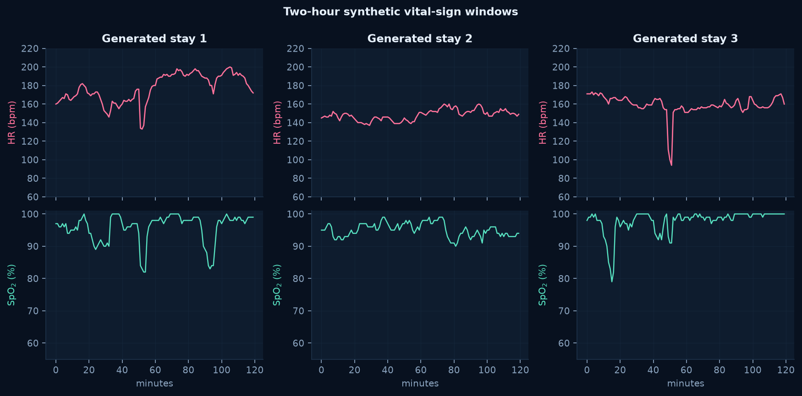
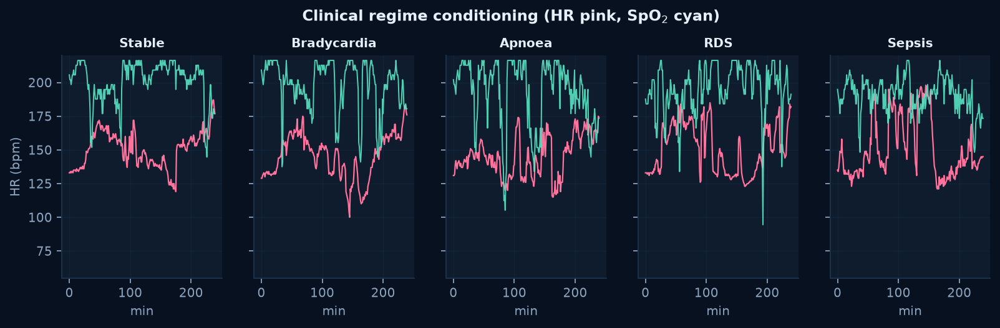

# NeoSim 2.0

**A generative, event-aware NICU patient simulator built around a single conditional flow-matching transformer.**

NeoSim 2.0 is a ground-up revamp of the original [NICU Patient Simulator](https://github.com/GurshanRiarh/NICU_PatientSimulator). The original system used four separate GANs for heart rate, respiration, bradycardia and tachycardia. NeoSim replaces them with **NeoFlow**, one multivariate conditional generator that produces coherent HR, respiratory rate and SpO₂ trajectories, while a physiology layer adds temperature, routine care effects, clinical events and downstream stability/pain/sepsis scores.

The output remains compatible with the original simulator's JSON schema, so existing NPSS-style downstream consumers can use the new generator without changing their data loader.



---

## What changed

| Area | Original simulator | NeoSim 2.0 |
| --- | --- | --- |
| Generative model | Four per-signal GANs | One conditional rectified-flow transformer (4.28M parameters) |
| Signals | HR, RR, bradycardia, tachycardia | Joint HR, RR, SpO₂; temperature via thermoregulation model |
| Conditioning | Signal-specific GAN choice | Patient profile, 16 clinical event channels, known prefix, elapsed time |
| Temporal consistency | Independent signal generators | One joint sequence model with channel masking and prefix inpainting |
| Uncertainty | Per-GAN noise | Stochastic flow sampling with calibrated correlated noise |
| Interface | Flask + Plotly GUI | FastAPI + offline ECharts dashboard, CLI, JSON API |
| Exports | Legacy patient JSON | Legacy JSON, CSV bundle, FHIR R4 collection bundle, JSON API |
| Shift length | Fixed 8-hour workflow | 1–48 hours, configurable resolution and care interventions |
| Data | Two 8-hour CSVs | PreMo (3,829 infants) + PICS (10 infants) + legacy CSV validation |

The model is intentionally **not** a production clinical system. It is a research simulator for synthetic-data experiments, algorithm development and interactive teaching.

---

## Architecture



The pipeline has five stages:

1. **Data layer** — PreMo and PICS are converted into 120-minute windows on a 1-minute grid. Missing channels are masked rather than imputed.
2. **Window builder** — Each window carries three normalized vital-sign channels, a 13-feature static profile, 16 event channels and a time feature.
3. **NeoFlow** — A six-layer transformer learns a conditional velocity field for rectified flow. Static context and event flags are injected through adaptive layer normalization; observed prefixes are passed as clean context tokens for rolling generation.
4. **Physiology layer** — Intervention response kernels, spontaneous-event enforcement, thermoregulation and monitor noise make the output clinically controllable and consistent.
5. **Outputs** — A dashboard, CLI and API expose the same simulation result as legacy JSON, CSV, FHIR or in-memory arrays.

### Why flow matching?

Rectified flow learns a short ODE that transports Gaussian noise to the data distribution. It gives:

- one model for all channels, so bradycardia and desaturation are generated jointly;
- fast inference (35 Euler steps) suitable for an interactive dashboard;
- classifier-free guidance for stronger condition adherence;
- inpainting-style conditioning for smooth hour-by-hour continuation.

---

## Quick start

Requirements: Python 3.12, [`uv`](https://docs.astral.sh/uv/), and optionally a CUDA GPU. The repository includes the trained checkpoint `models/neosim_flow.pt`; CPU inference works, but is slower.

```bash
git clone https://github.com/GurshanRiarh/NICU-Patient-Simulator-Revamped.git
cd NICU-Patient-Simulator-Revamped

uv sync --extra dev
uv run neosim info
uv run neosim serve --host 127.0.0.1 --port 8010
```

Open <http://127.0.0.1:8010>. Port 8000 is intentionally not assumed because it is commonly occupied by other local services.

If the checkpoint is missing, the simulator falls back to a physiology-only generator and prints a warning. Normalisation statistics are included in `data/processed/norm_stats.json`, so the fallback and API can still run.

### Generate a shift from the CLI

```bash
uv run neosim simulate \
  --patient-id SIM-RDS-001 \
  --ga 27 --weight-g 900 --age-days 2 \
  --condition rds --severity 0.72 \
  --hours 8 --interval 5 \
  --format all --out outputs/rds_demo
```

This creates:

```text
outputs/rds_demo/
├── simulation.json     # legacy-compatible patient record
├── dashboard.json      # full series + scores for custom front ends
├── vitals.csv
├── events.csv
├── interventions.csv
├── summary.json
└── fhir_bundle.json
```

Use `--seed` for reproducibility, `--interventions` to restrict routine care, or `--no-care-events` / `--no-closed-loop` to isolate the generator.

### JSON API

```bash
curl -s http://127.0.0.1:8010/api/simulate \
  -H 'Content-Type: application/json' \
  -d '{
    "patient_id": "API-001",
    "gestational_age_weeks": 28,
    "birth_weight_g": 1050,
    "postnatal_age_days": 21,
    "condition": "apnea_of_prematurity",
    "severity": 0.55,
    "shift_hours": 8,
    "interval_minutes": 5,
    "seed": 42
  }'
```

Useful endpoints:

| Method | Path | Purpose |
| --- | --- | --- |
| `GET` | `/health` | Model / CUDA status |
| `GET` | `/api/model` | Checkpoint metadata and validation loss |
| `GET` | `/api/presets` | Dashboard clinical presets |
| `POST` | `/api/simulate` | Full simulation payload |
| `POST` | `/api/export?format=json\|csv\|fhir` | Download legacy JSON, zipped CSV or FHIR |

The dashboard supports synchronized vitals, event bands, a clinical timeline, interventions, pain, stability and sepsis risk. Charts use a vendored ECharts build, so no internet connection is required after installation.

---

## Model card

| Item | Detail |
| --- | --- |
| Model | NeoFlow, conditional rectified-flow transformer |
| Parameters | 4,278,339 |
| Layers / width / heads | 6 / 192 / 6, dropout 0.1 |
| Inputs | 120 × 3 vital channels, 120 × 16 events, 13 static features, 1 time feature |
| Context | Optional 30–60 minute clean prefix for rolling generation |
| Sampling | 35 Euler steps, CFG scale 1.45, calibrated AR(1) initial noise |
| Training data | 93,706 training windows: PreMo + PICS, 75/25 weighted sampling |
| Validation | 5,683 PreMo + 64 PICS windows |
| Held-out test | 6,171 PreMo + 64 PICS windows |
| Optimizer | AdamW, cosine schedule, 500-step warmup, EMA 0.999 |
| Batch / epochs | 256 / 40 (14,640 steps) |
| Hardware | NVIDIA RTX 3080 Ti, 699 s wall-clock |
| Best validation loss | 0.4751 at epoch 29 |
| Checkpoint | `models/neosim_flow.pt` |

### Intended use

- Generating synthetic neonatal vital-sign shifts for research, education and pipeline testing.
- Stress-testing summarisation, event-detection and deterioration algorithms.
- Interactive exploration of how clinical conditions and care events affect vital signs.

### Out-of-scope use

- Clinical decision support, diagnosis, treatment or any direct patient-care use.
- Claims that synthetic patients are real patients or that the model is a medical device.
- Re-identification of infants in the source datasets.

### Data and conditioning

- **PreMo** contributes HR/SpO₂ and four REDCap event types (culture age, NEC surgery, intubation, extubation).
- **PICS** contributes HR/RR derived from ECG and respiration annotations. PICS contains only 10 infants; its test split is a single infant.
- Per-infant PICS gestational age and birth weight are **deterministic approximations** within published cohort ranges, because the public annotation package does not include per-infant metadata. This is a documented limitation, not measured metadata.
- Routine care events (feeding, handling, oxygen, medication, suction, etc.) are not labelled in the public training data. Their physiological effects are added by transparent, configurable kernels in `src/neosim/simulator/physiology.py`.
- Temperature is generated by a thermoregulation model, not by NeoFlow.

---

## Training and evaluation

Training used the held-out split protocol described in `src/neosim/data/preprocess.py`: PreMo windows are split by a CRC32 hash of patient ID (80/10/10), and PICS infants 1–8/9/10 form train/val/test.



### Held-out metrics

Synthetic cohorts were generated with the simulator for 100 two-hour shifts per dataset. Care-event and closed-loop effects were disabled for this evaluation so the reported numbers isolate the generative model and spontaneous-event conditioning. The metrics compare marginal distributions, autocorrelation, event rates, a real-vs-synthetic classifier and nearest-neighbour distance.

| Cohort | Channel | Real mean ± SD | NeoSim mean ± SD | KS ↓ | Wasserstein ↓ | ACF(1) real / synth |
| --- | --- | --- | --- | --- | --- | --- |
| PreMo | HR | 157.9 ± 15.0 | 157.8 ± 22.1 | 0.110 | 5.79 | 0.854 / 0.873 |
| PreMo | SpO₂ | 95.0 ± 4.7 | 95.7 ± 4.6 | 0.159 | 0.79 | 0.809 / 0.795 |
| PICS | HR | 155.8 ± 11.1 | 150.9 ± 17.3 | 0.270 | 6.62 | 0.825 / 0.857 |
| PICS | RR | 40.9 ± 5.2 | 43.7 ± 6.3 | 0.246 | 3.05 | 0.652 / 0.831 |

| Cohort | Real-vs-synthetic AUC ↓ | Nearest-neighbour DCR ratio |
| --- | --- | --- |
| PreMo | 0.903 | 0.999 |
| PICS | 0.851 | 0.999 |

An AUC of 0.5 would mean the classifier cannot separate real from synthetic windows. NeoSim is clearly better than chance but still distinguishable; this is an honest limitation of the current model. PreMo bradycardia and desaturation event rates were close to the held-out data (0.33 vs 0.10 bradycardia minutes/hour; 2.26 vs 2.07 desaturation minutes/hour).




### Generated examples




---

## Reproducing the pipeline

### 1. Download public data

```bash
uv run python scripts/download_data.py all --workers 24
```

PreMo is downloaded from the UVA Dataverse; PICS headers and annotations are downloaded from PhysioNet. The legacy 8-hour CSVs are already vendored under `data/legacy/` (from the original MIT-licensed repository). Raw data is not committed.

### 2. Preprocess

```bash
uv run python -m neosim.data.preprocess all --workers 12 --max-windows 32
```

The full PreMo preprocessing run used in this repository produced:

| Split | PreMo windows | PICS windows |
| --- | ---: | ---: |
| Train | 93,285 | 421 |
| Validation | 5,683 | 64 |
| Test | 6,171 | 64 |

`data/processed/norm_stats.json` is committed so the trained checkpoint remains usable without rerunning preprocessing.

### 3. Train

```bash
uv run python scripts/train.py \
  --epochs 40 --batch-size 256 --workers 4 \
  --out models/neosim_flow.pt
```

Training writes `results/training_history.json` and saves the best EMA checkpoint. It took 699 seconds on an RTX 3080 Ti.

### 4. Evaluate and regenerate figures

```bash
uv run python scripts/evaluate.py --n 100
uv run python scripts/make_figures.py
```

### 5. Test and lint

```bash
uv run pytest
uv run ruff check src scripts tests
```

---

## Legacy compatibility

`NeoSimulator.to_legacy_json()` emits the fields expected by the original simulator and NPSS-style summarisers:

```json
{
  "patient_id": "SIM-0001",
  "Sex": "Female",
  "Age": "Age: 14 Days",
  "Weight": "1.25 kg",
  "Conditions": ["stable_preterm"],
  "data": [
    {
      "timestamp": "2026-10-24 08:00:00",
      "vital_signs": {
        "heart_rate": "158 bpm",
        "respiratory_rate": "46 breaths/min",
        "body_temperature": "36.8 °C",
        "spo2": "96 %",
        "HR_Delta": null,
        "RespRate_Delta": null,
        "Temp_Delta": null
      },
      "pain_level": "Low",
      "intervention": [
        {"type": "feeding", "detail": "Enteral feed · 18 ml"}
      ],
      "stability": 97.4,
      "sepsis_risk": 0.012
    }
  ]
}
```

`stability`, `sepsis_risk`, `spo2`, `metadata` and `summary` are additive fields. Existing consumers that only read the original keys remain compatible.

---

## Repository layout

```text
.
├── src/neosim/
│   ├── config.py                 # signals, events, static features, runtime config
│   ├── data/                     # preprocessing and PyTorch datasets
│   ├── models/flow.py            # NeoFlow, EMA, flow loss, sampler
│   ├── simulator/
│   │   ├── events.py             # spontaneous and care-event scheduling
│   │   ├── physiology.py         # response kernels, enforcement, temperature
│   │   └── engine.py             # simulator, scoring, exports
│   ├── evaluation/metrics.py     # KS, Wasserstein, ACF, AUC, DCR
│   ├── cli.py                    # neosim simulate | serve | info
│   └── api/app.py                # FastAPI application
├── web/                          # offline dashboard (HTML/CSS/JS/ECharts)
├── scripts/                      # download, train, evaluate, figures
├── tests/                        # event, flow, engine, API and metric tests
├── data/legacy/                  # original 8-hour CSVs
├── docs/                         # PreMo README and licence
├── results/                      # evaluation, training history, figures
└── models/neosim_flow.pt         # trained checkpoint
```

---

## Limitations and safety

- **Research prototype.** Not a medical device and not validated for clinical use.
- **Small PICS cohort.** Only 10 infants are available; the test split is one infant, so PICS metrics are high-variance.
- **Approximate PICS metadata.** Gestational age and birth weight are cohort-level approximations, not per-infant measurements.
- **Care events are heuristic.** Routine care effects are physiologically motivated kernels, not learned from labelled interventions.
- **Conditioning is not causal.** The model reproduces associations in the training data; it does not establish treatment effects.
- **Residual distribution gap.** The real-vs-synthetic AUC remains around 0.85–0.90, and HR variability is somewhat high in the PreMo cohort.
- **No raw data redistribution.** PreMo is subject to its ODC-By licence; PICS is distributed through PhysioNet. Users must follow the original dataset terms.
- **Synthetic outputs must not be presented as real patient records.**

---

## Licence and citations

Code in this repository is released under the MIT Licence (see `LICENSE`). The original simulator is also MIT-licensed.

If you use this work, please cite the underlying paper:

```bibtex
@article{levine2026generative,
  title   = {Generative Simulation and Summarization of Neonatal Patient Data},
  author  = {Levine, Jesse and Riarh, Gurshan and Green, James R.},
  journal = {Information},
  year    = {2026},
  doi     = {10.3390/info17030261}
}
```

Datasets:

- **PreMo**: University of Virginia Dataverse, DOI `10.18130/V3/KCBTMS`, ODC-By licence. See `docs/PREMO_README.md` and `docs/PREMO_LICENSE.txt`.
- **PICS**: PhysioNet, `picsdb/1.0.0`, <https://physionet.org/content/picsdb/1.0.0/>. Check the PhysioNet licence and data-use terms before use.
- **Legacy CSVs**: original [NICU Patient Simulator](https://github.com/GurshanRiarh/NICU_PatientSimulator) repository (MIT).

---

## Contact

Gurshan Riarh — `Gurshanriarh@cmail.carleton.ca`

Repository: <https://github.com/GurshanRiarh/NICU-Patient-Simulator-Revamped>
